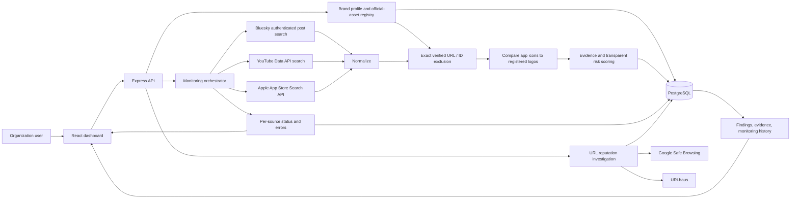

# Find_out architecture

## Monitoring flow

1. A user registers brand metadata and owned accounts/apps in the official asset registry.
2. A monitoring run queries the configured source adapters concurrently. Source data is normalized to a shared candidate shape.
3. Verified registered social identifiers, app IDs, and canonical URLs are checked before findings are scored. Exact matches are retained as excluded audit records and are not assigned threat risk.
4. Candidate evidence and a transparent rule-based risk assessment are written to `discovered_candidates`, `candidate_evidence`, and `risk_assessments`. The run summary and source errors are stored in `monitoring_runs`; operational run details are stored in `monitoring_jobs`.
5. The UI shows candidates, supporting source context, official exclusions, and unavailable-source status. A name match or keyword alone is not a malicious verdict.

## Storage

The API initializes/updates its PostgreSQL tables on startup. Core tables include `brands`, `official_assets`, `monitoring_runs`, `discovered_candidates`, `candidate_evidence`, `risk_assessments`, `official_asset_matches`, `investigations`, `evidence_items`, `source_audit_logs`, `complaints`, `alerts`, and `reports`. Legacy `brand_assets` rows from the SQL migration are copied into the active `official_assets` registry.

Source credentials are server-side environment variables only. Monitoring is synchronous in this prototype; scan duration is bounded by per-source request timeouts. Restricted and unconfigured sources are recorded as unavailable. External takedown submission and broad social-platform account enumeration are not implemented.
